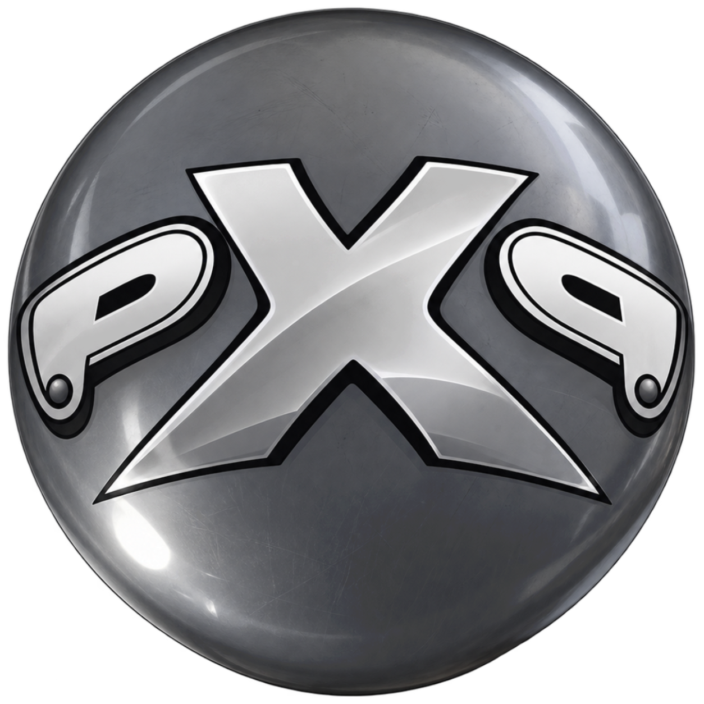
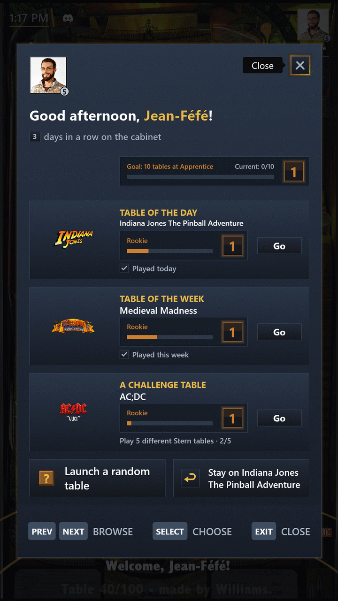

# PinballY eXpansion Pack

*[🇬🇧 English version](README.md)*

Extension non officielle de [PinballY](http://mjrnet.org/pinscape/PinballY.php) qui donne à chacun dans la maison un Profil, des Défis chaque semaine, des Succès et de vraies raisons de revenir sur votre pincab, sans toucher à PinballY.



## Profils

- Avec « Changer de joueur », chacun prend son Profil, et l'écran d'accueil vous salue par votre nom : vous savez pour qui les parties vont compter. Un nouveau Profil se crée depuis la borne avec les flippers, sans clavier : la saisie du nom, puis le Choix de l'Avatar parmi les portraits du pack. Seules les parties d'au moins une minute comptent, et le Profil Invité reste toujours là pour les visiteurs.
- Chaque Profil a ses propres notes en étoiles et ses tables favorites, que la notation et les favoris de PinballY montrent tant qu'il joue. Sur l'écran de la roue, cinq étoiles montrent votre propre note de la table sélectionnée, et un rappel vous propose de noter une table une fois que vous y avez assez joué.
- **"Mon profil"** résume votre vie de flippeur ; **"Stats de la maison"** montre tout le monde côte à côte, le meilleur de chaque ligne en doré.
- Un Profil admin garde les entrées de configuration pour vous, et un Profil enfant retire les tables pour adultes de la roue.

→ [Profils](docs/guide/fr/profiles.md)

## Succès et défis

- Un nouveau Défi chaque lundi, le même pour toute la maison, dont la carte suit votre progression sur l'écran de la roue.
- Des dizaines de Succès du Bronze au Platine, dont quelques secrets, chacun annoncé par un encart sans interrompre vos parties. Chaque Succès fait monter votre niveau, affiché sur votre Avatar.

→ [Succès et défis](docs/guide/fr/achievements_and_challenges.md)

## Choisir une table

- L'écran d'accueil propose la table du jour et la table de la semaine : jouez-les plusieurs jours ou semaines d'affilée pour faire une série sur la table du jour ou de la semaine.
- Chaque minute passée sur une table fait monter votre maîtrise de celle-ci, de Novice à Mage du flipper.
- Les meilleurs scores sont attribués au Profil qui jouait, quelles que soient les initiales, et présentés sur un podium : le tableau de la table, les meilleurs de la maison, et vos cinq meilleurs. Avec [vpxtool](docs/guide/fr/install.md#vpxtool), sur les tables à ROM dont la mémoire garde le dernier score, une partie qui n'entre pas au tableau de la table compte quand même sur ces deux derniers comme score de partie, et un record perso ou un record de la maison est annoncé.
- À court d'idées ? Une table au hasard tourne sur une roue de la fortune.

→ [Choisir une table](docs/guide/fr/choosing_a_table.md)

## Interface

- Les menus et messages de PinballY en français, anglais, allemand, espagnol, italien ou portugais, dessinés dans le style Steamball du pack et rangés en sections.
- Une horloge de la roue, une horloge du backglass pour vos parties une fois activée, un arc doré sous la roue, des lancements sans flash noir, et des sons que vous pouvez remplacer par les vôtres.
- **Discord Rich Presence** (), une fois activé, montre à vos amis Discord la table que vous jouez et depuis combien de temps.
- **"Réglages de l'eXpansion pack"**, dans le menu opérateur, active ou désactive chaque Add-on.

→ [Interface](docs/guide/fr/interface.md) · [Discord Rich Presence](docs/guide/fr/settings.md#discord-rich-presence)

## Installation

Nécessite **Windows** et **PinballY 1.1.0 Beta 10** (plus la fonctionnalité facultative *Lecteur Windows Media* pour les sons, déjà présente sur Windows 10 et 11). Pas besoin de git.

1. **Téléchargez `ExpansionPack.zip`** depuis la dernière version publiée : https://github.com/F3L1X79/PinballY-Expansion-Pack/releases/latest (et non « Source code (zip) », dont le dossier n'est pas trouvé par le pack).
2. **Extrayez-le dans `PinballY\Scripts`** : vous devez obtenir `PinballY\Scripts\ExpansionPack\main.js`, et non `ExpansionPack\ExpansionPack\main.js`.
3. **Créez `PinballY\Scripts\main.js` avec cette seule ligne**, ou **ajoutez-lui cette ligne** s'il existe. Vos propres scripts continuent de fonctionner.
   ```js
   import("./ExpansionPack/main.js").catch(e => logfile.log("ExpansionPack: " + e.message));
   ```
4. **Redémarrez PinballY.** `PinballY.log` montre une ligne « initialized » par Add-on ; les erreurs sont aussi gardées dans `Scripts\ExpansionPack\logs\errors.log`.
5. **Choisissez vos Add-ons**, l'écran de démarrage et la langue dans **Réglages de l'eXpansion pack**, depuis le menu opérateur, puis redémarrez PinballY d'une seule pression.

Vos réglages et vos Profils restent dans `Scripts\ExpansionPack` : copiez ce dossier pour sauvegarder, supprimez-le avec la ligne d'import pour désinstaller un jour au besoin. Quand une nouvelle version du pack sort, PinballY propose la mise à jour au démarrage, d'une seule pression, en gardant vos réglages et vos Profils.
Pour PINemHi 3.6.8, `.env.local` et l'installation avec git : voir la [page d'installation](docs/guide/fr/install.md) pour les étapes complètes.

## En savoir plus

- 📖 **[Guide du joueur](docs/guide/fr/index.md)** : installation, mises à jour, chaque fonctionnalité, réglages et dépannage, page par page.
- **[CHANGELOG](CHANGELOG.md)** (en anglais) : ce qui a changé à chaque version.
- **[Guide du contributeur](https://github.com/F3L1X79/PinballY-Expansion-Pack/blob/main/CONTRIBUTING.md)** (en anglais) : organisation du code, conventions, tests et ajout d'une langue.

## Licence et crédits

**PinballY eXpansion Pack, de Félix Chrétien** ([F3L1X79](https://github.com/F3L1X79)), sous GNU GPL v3 ou ultérieure. Voir [LICENSE](LICENSE) et [NOTICE](NOTICE). Vous pouvez l'utiliser, le modifier et le partager ; un fork ou toute reprise de son code reste sous GPL et garde ce crédit, avec un lien vers ce dépôt.

- **[PinballY](http://mjrnet.org/pinscape/PinballY.php)**, de Michael J Roberts (GPL v3 ou ultérieure) : le frontend sur lequel tourne tout le pack, grâce à son API JavaScript. Sans lui, rien de ce projet fou ne serait possible.
- **[vpin-studio](https://github.com/syd711/vpin-studio)**, de Matthias Faust / syd711 (MIT) : les règles de lecture des High Scores sont reprises de ses analyseurs de scores.
- **[fireworks-js](https://github.com/crashmax-dev/fireworks-js)**, de Vitalij Ryndin / crashmax-dev (MIT) : le mouvement des fusées du feu d'artifice en est adapté.
- **[react-confetti](https://github.com/alampros/react-confetti)**, d'Aaron Lampros (MIT), et **[canvas-confetti](https://github.com/catdad/canvas-confetti)**, de Kiril Vatev (ISC) : la pluie de confettis reprend leurs tailles, vitesses, courbe d'animation et couleurs.
- **Sons** de [Freesound](https://freesound.org) (CC0) : auteurs listés dans [assets/sounds/CREDITS.md](assets/sounds/CREDITS.md).
- **[vpxtool](https://github.com/francisdb/vpxtool)**, de Francis De Brabandere (Apache-2.0) : remplit la ROM de chaque table. Téléchargé par la borne depuis les versions de son auteur, une fois que le propriétaire l'accepte.
- **[PINemHi](https://www.pinemhi.com/)** , de Dna Disturber : fourni avec PinballY avec la permission de son auteur. Non fourni avec le pack.
