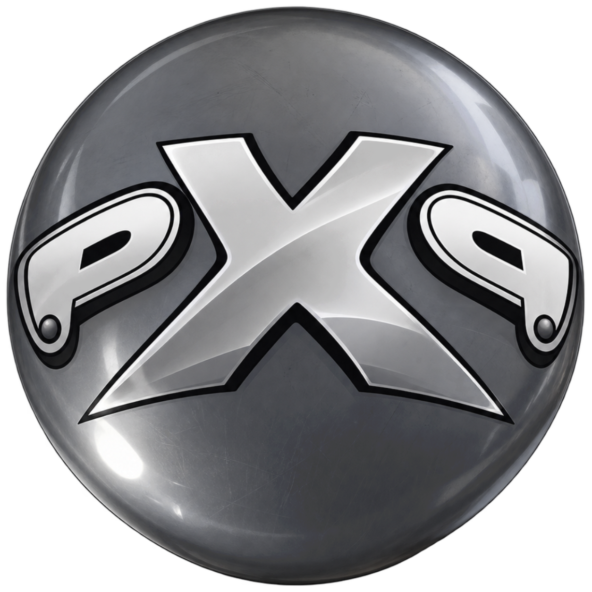
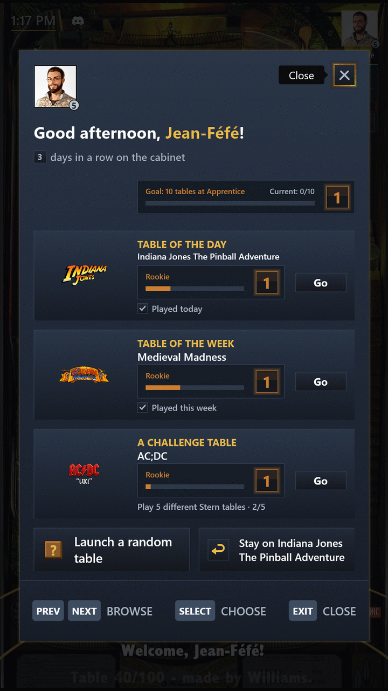

# PinballY eXpansion Pack

*[🇫🇷 Version française](README.fr.md)*

An unofficial extension of [PinballY](http://mjrnet.org/pinscape/PinballY.php) that gives everyone in the house a Profile, weekly Challenges, Achievements and a real reason to come back to your pincab, without touching PinballY.



## Profiles

- Each of you picks your own Profile and Avatar with Change Player, and the Welcome Screen greets you by name, so you know whose games will count. Only games of a minute or more count, and Guest is always there for visitors.
- Each Profile has its own star ratings and Favorite Tables, which PinballY's own rating dialog and favourites show while it plays.
- **"My Profile"** sums up your pinball life; **"Household Stats"** sets everyone side by side, the best of each line in gold.
- An Admin Profile keeps the setup entries for you, and a Child Profile leaves the Adult Tables off the wheel.

→ [Profiles](docs/guide/en/profiles.md)

## Achievements and Challenges

- A new Challenge every Monday, the same for the whole household, its card tracking your progress on the wheel screen.
- Dozens of Achievements from Bronze to Platinum, a few of them secret, each announced by a toast without interrupting your games. Every one of them raises your Player Level, shown on your Avatar.

→ [Achievements and Challenges](docs/guide/en/achievements_and_challenges.md)

## Choosing a table

- The Welcome Screen offers the Table of the Day and the Table of the Week: play them several days or weeks in a row to build a Table of the Day or Table of the Week Streak.
- Every minute on a table builds your Mastery Level of it, from Rookie to Pinball Wizard.
- High Scores are credited to the Profile that played, whatever the initials, and shown on a podium: the table's board, the household's best, and your own best five.
- Short of ideas? A Random Game spins on a wheel of fortune.

→ [Choosing a table](docs/guide/en/choosing_a_table.md)

## Interface

- PinballY's menus and messages in English, French, German, Spanish, Italian or Portuguese, drawn in the pack's Steamball look and sorted into sections.
- A clock, a gold arc under the wheel, launches without a black flash, and sounds you can replace with your own.
- **Discord Rich Presence** (), once you turn it on, shows your Discord friends the table you are playing and for how long.
- **"eXpansion Pack Settings"**, in the Operator Menu, turns each Add-on on or off.

→ [Interface](docs/guide/en/interface.md) · [Discord Rich Presence](docs/guide/en/settings.md#discord-rich-presence)

## Install

Requires **Windows** and **PinballY 1.1.0 Beta 10** (plus the *Windows Media Player* optional feature for the sounds, already there on Windows 10 and 11). No git needed.

1. **Download `ExpansionPack.zip`** from the latest release: https://github.com/F3L1X79/PinballY-Expansion-Pack/releases/latest (not "Source code (zip)", whose folder isn't found by the pack).
2. **Extract it into `PinballY\Scripts`**: you should get `PinballY\Scripts\ExpansionPack\main.js`, not `ExpansionPack\ExpansionPack\main.js`.
3. **Create `PinballY\Scripts\main.js` with only this line**, or **add this line to it** if it exists. Your own scripts keep running.
   ```js
   import("./ExpansionPack/main.js").catch(e => logfile.log("ExpansionPack: " + e.message));
   ```
4. **Restart PinballY.** `PinballY.log` shows one "initialized" line per Add-on; errors are also kept in `Scripts\ExpansionPack\errors.log`.
5. **Choose your Add-ons**, the startup screen and the language in **eXpansion Pack Settings**, in the Operator Menu, then restart PinballY in one press.

Everything the pack keeps (settings and Profiles) stays in `Scripts\ExpansionPack`: copy this folder to back up, and simply delete it and the import line to uninstall this pack if you don't want it anymore.
For PINemHi 3.6.8, `.env.local` and installing with git: see the [install page](docs/guide/en/install.md) for the complete steps.

## Learn more

- 📖 **[Player guide](docs/guide/en/index.md)**: install, updates, every feature, settings and troubleshooting, page by page.
- **[CHANGELOG](CHANGELOG.md)**: what changed in each version.
- **[Contributor guide](https://github.com/F3L1X79/PinballY-Expansion-Pack/blob/main/CONTRIBUTING.md)**: module layout, conventions, tests and adding a language.

## License and credits

**PinballY eXpansion Pack by Félix Chrétien** ([F3L1X79](https://github.com/F3L1X79)), under the GNU GPL v3 or later. See [LICENSE](LICENSE) and [NOTICE](NOTICE). You are free to use, modify and share it; a fork or any reuse of its code must stay under the GPL and keep this credit, with a link to this repository.

- **[PinballY](http://mjrnet.org/pinscape/PinballY.php)** by Michael J Roberts (GPL v3 or later): the frontend the whole pack runs on, through its JavaScript API. Without it, none of this crazy project would be possible.
- **[vpin-studio](https://github.com/syd711/vpin-studio)** by Matthias Faust / syd711 (MIT): the High Score reading rules are ported from its score parsers.
- **[fireworks-js](https://github.com/crashmax-dev/fireworks-js)** by Vitalij Ryndin / crashmax-dev (MIT): the rocket motion of the fireworks is adapted from it.
- **[react-confetti](https://github.com/alampros/react-confetti)** by Aaron Lampros (MIT) and **[canvas-confetti](https://github.com/catdad/canvas-confetti)** by Kiril Vatev (ISC): the Confetti Shower follows their sizes, speeds, easing and colours.
- **Sounds** from [Freesound](https://freesound.org) (CC0): authors listed in [assets/sounds/CREDITS.md](assets/sounds/CREDITS.md).
- **[vpxtool](https://github.com/francisdb/vpxtool)** by Francis De Brabandere (Apache-2.0): fills in each table's ROM. Downloaded by the cabinet from its author's releases, once the owner agrees.
- **[PINemHi](https://www.pinemhi.com/)** by Dna Disturber: supplied with PinballY by permission of its author. Not included in the pack.
