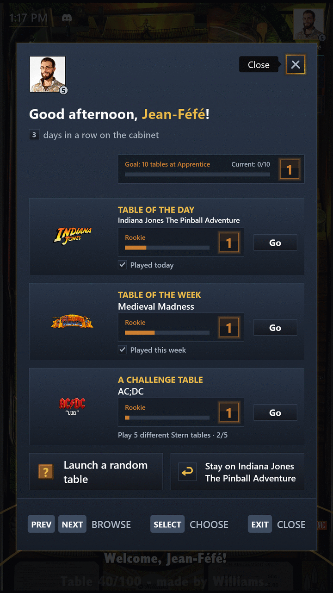
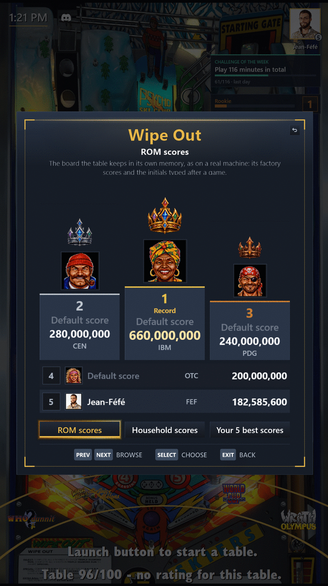

# Choosing a table

[← Guide index](index.md)

## Welcome Screen: Table of the Day, Table of the Week

Every day there is a table nobody in the house has played yet, or the one left alone the longest, and every week a random one. The Welcome Screen greets you with both at startup, again after Change Player, and whenever you pick **Welcome Screen** in the main menu, with what they mean for you.

- While your weekly Challenge has Challenge Tables, it also shows one of them, drawn at random. That Challenge Table is never one of the two tables already shown, unless one more game finishes your Challenge.
- From there, launch one of them, stay on the table on the wheel, change player or spin a Random Game.
- Play them several days or weeks in a row to build a Streak.
- Neither is ever a hidden table or an unconfigured one (a table file PinballY found but that was never set up), even when your wheel shows it.
- When someone else takes one of your High Scores, Guest included, your next Welcome Screen tells you who, once, so you know which record to win back.
- While the Welcome Screen is open, the video sound of the table on the wheel is turned down, and comes back as it closes.

For a Child Profile, see [Settings](settings.md#child-profile): the Table of the Day and the Table of the Week stay the same for the whole household.

## Table Mastery

Every minute you play a table builds your Table Mastery of it, through ten Mastery Levels from Rookie to Pinball Wizard, each longer to reach than the one before.

- The Mastery Bar, at the top right of the wheel screen, shows how far you are on the selected table, and a toast announces the level you reach.
- Under it, five stars give your own Rating of the selected table, and change as soon as you rate it. A table you have not rated has none: a zero shows as five empty stars.
- The lower status line gives what the whole household thinks of the selected table: its Household Rating, the average of your Ratings rounded to the half star, with how many of you rated it (see [Profiles](profiles.md#ratings-and-favorite-tables)).
- When ten of your tables reach the next level, your Collection Mastery climbs a tier. Hidden and unconfigured tables do not count.
- Mastery Level 10 on a table and each new Collection Tier bring a shower of confetti.
- Each Collection Tier also unlocks an Avatar Frame, from the Enchanted Forest to the Celestial Legend, to wear around your Avatar: pick it in **My Profile**, under **Frame**.
- Play on a holiday (New Year's Day, Chinese New Year, Valentine's Day, Easter, Halloween, Christmas and five more) and that day's Holiday Frame is yours for good, announced by a toast when you come back to the wheel.

## High Scores

When you enter a table's high score board, the place is yours: the pack reads the board before and after each game and, for a game of a minute or more, credits every new score to the Profile that was playing, whatever initials were typed, the other players of a multiplayer game included.

- A toast announces your best place, or the Table Record and whom you took it from.
- With [vpxtool](install.md#vpxtool), a game that wins no place can still get a toast: **House Record** when its score takes the first place of **Household scores** from another Profile (and names it), else **Personal Best** when it beats all your earlier scores on the table, never for your first one. Guest can get a Personal Best, never a House Record. One toast per game, the strongest.
- The scores already on the board at the first read, factory ones included, belong to no one, and a ROM reset that brings them back is never credited.
- A High Score stays won even once later scores push it off the board, and earns its own Achievements.
- **My Profile** shows the High Scores and Table Records you still hold, and **Household Stats** who holds the most Table Records.
- Tables without a ROM (community originals) count too: the pack reads their board in Visual Pinball X's `User` folder (`VPReg.stg`, or the text file some tables keep there), learns where each table keeps it during its first game, and hands it to PinballY, so the DMD and the table's info box show it as well. Their board appears once such a table has been played with the pack.

**High Score Boards** in the main menu (or PinballY's `HighScores` button, if mapped) opens the selected table's board, drawn in the Steamball look in place of PinballY's own window:

- the three first places on a podium under a Gold, Silver and Bronze crown, the others in rows below;
- each with its rank, score, initials and the Profile that won it (name, Avatar and Avatar Frame), or "Default score" with a portrait picked by its initials, the same on every table;
- the board is read again from the table each time you open it, so it always shows what the table holds now;
- on a board too long for the screen, the flippers also stop on each place below the podium, scrolling it into view.

Three buttons under the board, one per view, show the view on show in gold; under the table's title, the view's own title says in a line or two what it shows, and every view keeps the same size. The board opens with its first button chosen; the flippers move from one button to the next, then to the Exit Button; Select (or Launch) opens the view of the button chosen, or closes the board on the Exit Button; Exit closes it from any view:

- **ROM scores**: the table's own board, as above, where every opening starts;
- **Household scores**: each Profile of the household (Guest left out, children in) once, with its best score on this table, a score since pushed off the table's board included, and the date of that game; after a Profile Reset, only the scores won since count;
- **Your 5 best scores**: the five best High Scores of the Profile playing now on this table (Guest's too), those pushed off the table's board and each one of a multiplayer game included, with the date of each game; after a Profile Reset, only those won since.

With [vpxtool](install.md#vpxtool) installed, **Household scores** and **Your 5 best scores** count every Play on a ROM table whose memory keeps the last game's score, even one far below the table's Default Scores: the pack reads the score the game ended with from the ROM's `.nv` file, the best of a multiplayer game, and keeps it as a Play Score, shown like a High Score. A game that also entered the table's board shows only once. A game left unfinished, when the table tells it, and a launch without a game give no Play Score. Play Scores count from the update that brought them on; earlier games cannot be recovered. This program makes use of content from the [Pinball Memory Maps](https://github.com/tomlogic/pinball-memory-maps) project.

The rules that read a Play Score were checked on a few kinds of tables only, so the pack notes what looks wrong (a game always seen as unfinished, a score that should have entered the board, a ROM vpxtool cannot read…) in `Scripts\ExpansionPack\play_scores_anomalies.log`, one line per oddity, the ordinary games never. Send it (and `play_scores_anomalies.old.log`, its older part, if there is one) with a report about a missing or wrong Play Score.

To read the boards of about 300 more ROMs, update PINemHi (see [Install](install.md#pinemhi-368)).

## Random Game and filters

- A Random Game is spun on a wheel of fortune (`SKIP_RANDOM_GAME_ANIMATION=true` launches it at once). Launch one from the Welcome Screen, or from "Launch a random table" in the main menu, under "Play": it draws from the tables on the wheel, the Active Filter included.
- Behind "Change Filter" in the main menu: "Tables to Discover", "Most Played Tables", "My High Scores" (the tables where you hold a place on the board), "Favorite Tables", "Hidden Tables" (while a table is hidden), "Original Tables" (the manufacturer set by `COMMUNITY_TABLES_MANUFACTURER`) and "Challenge Tables".
- A reminder asks you to rate a table once you have played it long enough (`ASK_TO_RATE_AFTER_MINUTES_PLAYED`), unless your Profile has rated it already.
- Star ratings and "Favorite Tables" are the active Profile's own: what you rate or add to the favourites changes nobody else's (see [Profiles](profiles.md#ratings-and-favorite-tables)).

---

[← Guide index](index.md)
