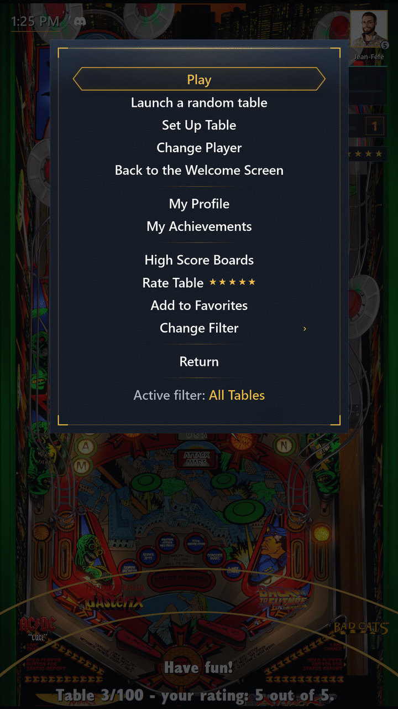

# Interface

[← Guide index](index.md)

## PinballY in 6 languages

PinballY's own menus and messages in French, German, Spanish, Italian or Portuguese, as well as English. Pick the language in **eXpansion Pack Settings**, or with `LANGUAGE` in `.env.local` (see [Settings](settings.md)).

## Drawn menus

PinballY's menus and other scripts' menus are drawn in the pack's Steamball look, with the same entries, sorted into sections, and the same buttons: the main menu, Exit, filters, power off, table setup, the Operator Menu, a game's pause, media capture (batch capture included) and confirmations.

- In the main menu, Rate Table shows the selected table's Rating when it has one: five stars after its name, half stars included, as under the Mastery Bar ("Rate Table (current: 4.5 / 5)" in PinballY's own menu). It is the active Profile's own Rating, unless **Ratings per Profile** is off (see [Ratings and Favorite Tables](profiles.md#ratings-and-favorite-tables)).
- In the pause, Exit and "Cancel" resume the game.
- On every drawn menu and screen, a held Select, Launch or Exit counts once, while a held flipper keeps going.
- Drawn menus and screens play PinballY's button sounds, like the wheel: your own if they are in `Media\Button Sounds`, at PinballY's button volume. **Mute Buttons** in the Operator Menu silences them all; a copy of `Silence.wav` (in PinballY's `Assets` folder) named after one sound silences only that one, such as `Next.wav` and `Prev.wav` for moves.
- A shorter main menu gathers every wheel selection and filter group behind one "Change Filter" entry, and names the filter the wheel shows under its list ("Active filter: All Tables").

## Menu Cleanup

Menu Cleanup lightens PinballY's menus for every Profile, Admin Profiles included. It removes:

- Help and About from the Exit and Operator menus;
- Information, Flyer and Instruction Card from the main menu (Rate Table and Add to Favorites stay);
- PinballY's own High Scores entry (named **Table Scores** in the main menu) when the pack's High Scores are turned off;
- the Filter by Last Played and Filter by Date Added groups from "Change Filter";
- the Filter by System group, only when your configured tables use a single system (only Visual Pinball X, say): with two systems or more (Visual Pinball X and Pinball FX, for instance), it stays.

It is **off by default**, like the Backglass Clock: turn it on with `ADD_ON_MENU_CLEANUP=true`. PinballY's dedicated buttons for these screens, if you mapped them, still work.

## On the wheel screen

- A clock, a gold arc under the wheel (the Wheel Arc) and a richer status line.
- The active Profile's badge with its Player Level, the week's Challenge Card and the Mastery Bar.
- Under the Mastery Bar, in the top right corner, five stars: the active Profile's Rating of the selected table, half stars included. They take the bar's place when Table Mastery is off, and are absent on a table you have not rated or when **Ratings per Profile** is off.
- The lower status line ends with the selected table's Household Rating ("Table 3/120 - household rating: 3.5 out of 5 (4 ratings)."), or your own Rating when fewer than two of you rated it ("your rating: 4 out of 5."), otherwise "no rating for this table." It follows a rating at once, and is absent when **Ratings per Profile** is off (see [Ratings and Favorite Tables](profiles.md#ratings-and-favorite-tables)).

## Status Icons

Small icons sit right of the wheel's clock, on its line, as tall as its digits. Each one shows only while what it stands for lasts:

- Discord's white symbol, to everyone, Guest and Child Profiles included: Discord is showing the cabinet publicly right now (see [Discord Rich Presence](settings.md#discord-rich-presence)). No symbol means nothing is public: Discord Rich Presence is off, Discord has not answered yet or cannot be reached, or attract mode is running.
- A gold arrow pointing down, only to whoever sees the setup entries (an [Admin Profile](settings.md#admin-profile), or anyone while no Profile is marked): a newer version of the pack is waiting (see [Updates](updates.md)).
- A white circular arrow, crossed out, only to whoever sees the setup entries: the pack update check is turned off.

They keep their place when the minute changes and when the clock is turned off, hide during a game, and follow the active Profile after Change Player. An icon that comes or goes while you are on the wheel fades once. Turn them off with "Status Icons" in the wheel screen group of **eXpansion Pack Settings**, or `ADD_ON_STATUS_ICONS=false`.

## Launches, waits and sounds

- Launches without a black flash, with a gold comet turning while you wait, the step under way written in gold beneath it while a table launches or closes ("Loading…", "Returning to tables…"): during a launch, at startup, while a high score board is read and while the Profile Stats, the Household Stats, the Achievement List or the Avatar Frame list get ready.
- While a table loads and closes, the comet also turns alone in the middle of the backglass, never while PinballY captures a table's media.
- The backglass hidden during a game.
- Sounds for launches, Achievements, greetings, confetti and fireworks, or your own (see [Settings](settings.md)).

## Backglass Clock

While a table runs, the Backglass Clock shows the time in a small box with the Steamball menus' blue gradient and a thin gold frame, in front of VPX's backglass, with the same format, drop shadow and gold underline as the wheel's clock. It appears as soon as you launch the table, while it loads, changes when the minute does, and goes when the game ends or the launch fails. It never shows on a single-screen cabinet or while PinballY captures a table's media.

It is **off by default**: turn it on in the eXpansion Pack Settings or with `ADD_ON_BACKGLASS_CLOCK=true`. At its first game, the box opens in the very top right corner of the backglass screen. During a game, drag it with the mouse: its place is saved when the game ends and used for the next ones, even after PinballY restarts. A click may send it behind the backglass: it comes back in front within two seconds and can then be dragged normally. Avoid right-clicking: that menu can rotate the box's contents. A backglass set to stay in front (B2S "FormToFront" on) may hide it.

---

[← Guide index](index.md)
