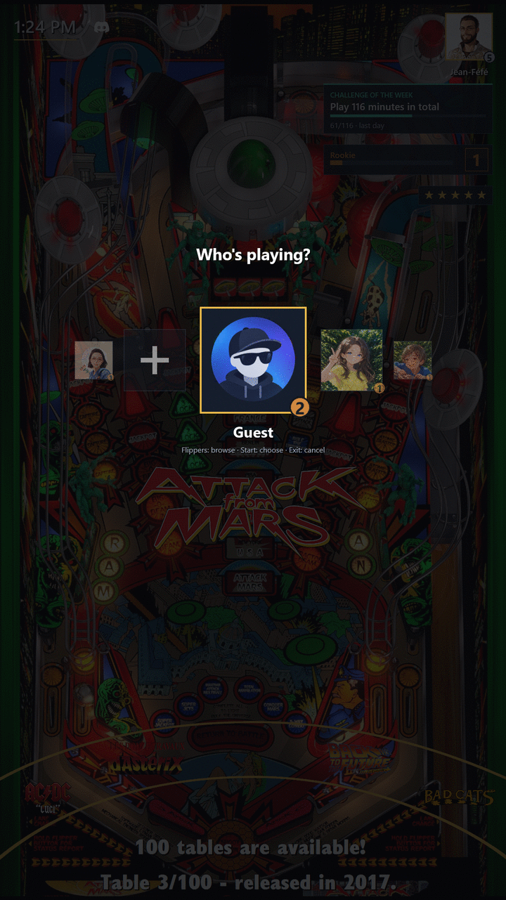
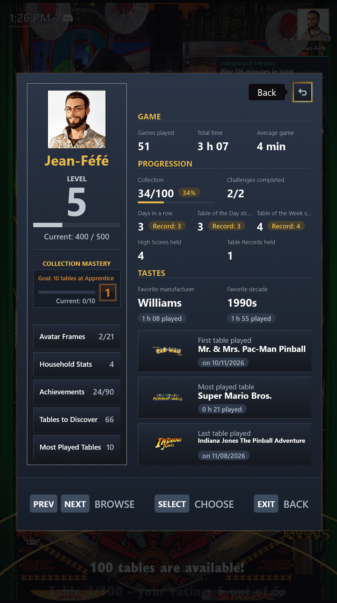

# Profiles

[← Guide index](index.md)

## A Profile for everyone

With Change Player, each of you picks your own Profile and Avatar, and the Welcome Screen greets you by name so you know whose games will count.

- Only games of at least a minute count, so a launch by mistake never spoils anything.
- Your Daily Streak counts the days in a row you have played, on any table.
- Guest is always there for visitors.
- Once the cabinet has two Profiles or more besides Guest, PinballY starts on Change Player so that everyone picks their Profile before playing; it can also start on the Welcome Screen or straight on the wheel (`STARTUP_SCREEN`, see [Settings](settings.md)).
- While Change Player is open, the video sound of the table on the wheel is turned down, and comes back as it closes.

Each Profile's progress is saved in `Scripts\ExpansionPack\profiles`. An Admin Profile keeps the setup entries for itself, a Child Profile hides the Adult Tables, and an Admin Profile's **Manage profiles**, in the Exit menu, marks a Child Profile or starts a Profile over: see [Settings](settings.md).

## Create a Profile

The pack ships with Guest alone. A Profile is created from the cabinet or from Windows.

### From the cabinet

Open **Change Player**: its last slot, after the last Profile, is **New profile**, the "+". It shows for everyone while no Profile is an Admin Profile, Guest included; once one is, only for Admin Profiles.

1. Choose the "+" with Select or Launch: Name Entry opens.
2. Move along the ring of characters with the flippers, and hold one to keep going. Select or Launch chooses the character under the marker: `A` to `Z`, `a` to `z`, `-`, `←` to erase the last character, and `OK`.
3. Choose `OK`. `OK` stays grey while the name is empty or refused.
4. Change Player comes back on the new Profile, in its alphabetical place. You are still on your former Profile: press Select to pick the new one.

Exit goes back to the "+" with nothing created. On a cabinet left idle, attract mode closes Name Entry and Change Player, with nothing created either.

A name has 12 characters at most, without accents, spaces or digits. For a longer or accented name, rename the Profile's folder in Windows, **before playing**: a rename keeps the Profile's plays and Achievements, but its High Scores and Lost Records follow the name, and renaming the active Profile's folder restarts on Guest.

Whatever the letter case, Name Entry refuses Guest's name, `guest` or as your language shows it, the names Windows reserves (`CON`, `PRN`, `AUX`, `NUL`) and the name of a Profile already listed, and writes why under the ring. Nothing else is refused: a Profile set aside as `_Max` or a removed one leaves its name free. A hyphen does nothing at the start of a name or right after another one, and a hyphen at the end is dropped: "Max-" is created as "Max".

If the folder cannot be created, Name Entry stays open with your name and says so in one sentence: check the `profiles` folder in Windows and try again. The error is in the Error Log.

**The first Profile.** While the cabinet has no Profile besides Guest, Name Entry shows one more line, in yellow: the Profile you create becomes an Admin Profile instead of Guest. Pick it as soon as Change Player comes back on it: until you do, you stay on Guest, which no longer sees the setup entries nor the "+". If its mark cannot be saved, the Profile is kept, the error is in the Error Log, and you can still pick it and choose **Become admin** in **Manage profiles**. A Profile created once the cabinet has another one gets no mark, even if none of them is an Admin Profile, and neither does a first Profile created from Windows.

### From Windows

1. In `PinballY\Scripts\ExpansionPack\profiles`, create an empty folder named after the player: the cabinet shows that name. A name starting with `.` or `_` is ignored. Don't copy Guest's folder: the copy would carry over Guest's progress, while an empty folder starts from zero.
2. Optional: put a square PNG or JPEG named `avatar.png` or `avatar.jpg` in that folder. Without it, the Profile gets the default Avatar.
3. Open **Change Player**, in the main menu or the Exit menu, and pick the new Profile. There is no need to restart PinballY. Until you pick it, you are still playing as Guest.
4. Optional: to keep the setup entries for yourself, open **Manage profiles** in the Exit menu and choose **Become admin** (see [Admin Profile](settings.md#admin-profile)).

You don't need an Admin Profile to set up the pack: while no Profile is marked, every Profile, Guest included, sees the setup entries.

## My Profile

**My Profile**, in the main menu, sums up your pinball life:

- games played and total time, and the average game length;
- your Player Level and Collection Mastery;
- your favourite manufacturer, decade and table, and the first table you ever played;
- how much of the collection you have tried;
- your Achievements, your Daily Streak and your Table of the Day and Table of the Week Streaks, and the Challenges you completed;
- the High Scores and Table Records you still hold;
- the Avatar Frame you wear (pick it under **Frame**, see [Table Mastery](choosing_a_table.md#table-mastery));
- and the way to your most played tables and to the ones still to discover.

## Household Stats

Once two of you have a Profile, **Household Stats** sets every Profile but Guest side by side, Avatars in their frames, the best of each line in gold, and shows who holds the most Table Records. Pick a column to see that Profile's own stats.

---

[← Guide index](index.md)
