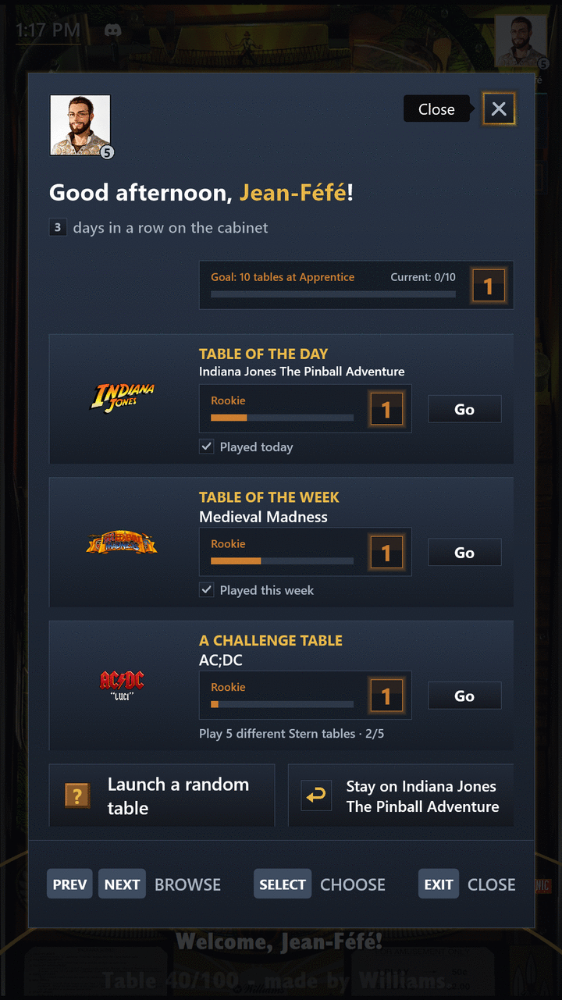
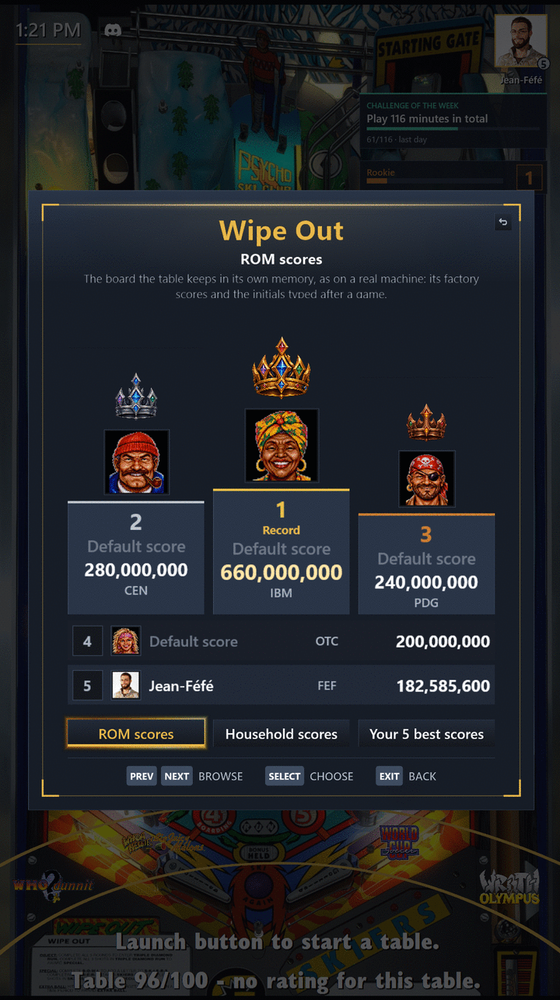

# Choisir une table

[← Sommaire du guide](index.md)

## Écran d'accueil : table du jour, table de la semaine

Chaque jour une table que personne à la maison n'a encore jouée, ou celle délaissée depuis le plus longtemps, chaque semaine une table au hasard. L'écran d'accueil vous les présente au démarrage, après chaque « Changer de joueur », et chaque fois que vous choisissez **Écran d'accueil** dans le menu principal, avec ce qu'elles représentent pour vous.

- Tant que votre défi de la semaine a des tables du défi, il montre aussi l'une d'elles, tirée au hasard. Cette table du défi n'est jamais l'une des deux tables déjà présentées, sauf quand une partie de plus termine votre défi.
- De là, lancez l'une d'elles, restez sur la table de la roue, changez de joueur ou tentez une table au hasard.
- Jouez-les plusieurs jours ou plusieurs semaines d'affilée pour faire une série.
- Ni l'une ni l'autre n'est jamais une table masquée ou non configurée (un fichier de table trouvé par PinballY mais jamais configuré), même quand votre roue l'affiche.
- Quand quelqu'un d'autre vous prend un record, Invité compris, votre prochain écran d'accueil vous dit qui, une seule fois, pour que vous sachiez quel record reprendre.
- Tant que l'écran d'accueil est ouvert, le son des vidéos de la table de la roue est baissé, et revient à sa fermeture.

Pour un Profil enfant, voir [Réglages](settings.md#profil-enfant) : la table du jour et la table de la semaine restent les mêmes pour toute la maison.

## Maîtrise des tables

Chaque minute passée sur une table fait monter votre maîtrise de celle-ci, sur dix niveaux, de Novice à Mage du flipper, chacun plus long à atteindre que le précédent.

- La barre de maîtrise, en haut à droite de l'écran de la roue, montre où vous en êtes sur la table sélectionnée, et un encart annonce le niveau atteint.
- Dessous, cinq étoiles donnent votre propre note de la table sélectionnée, et changent dès que vous la notez. Une table que vous n'avez pas notée n'en a pas : un zéro s'affiche en cinq étoiles vides.
- La ligne d'état du bas donne l'avis de toute la maison sur la table sélectionnée : sa note de la maison, la moyenne de vos notes arrondie à la demi-étoile, avec le nombre d'entre vous qui l'ont notée (voir [Profils](profiles.md#notes-et-tables-favorites)).
- Quand dix de vos tables atteignent le niveau suivant, la maîtrise de votre collection passe un palier. Les tables masquées et non configurées ne comptent pas.
- Le niveau 10 sur une table et chaque nouveau palier font pleuvoir des confettis.
- Chaque palier débloque aussi un cadre pour votre Avatar, de la Sylve enchantée à la Légende céleste : choisissez celui que vous portez dans **Mon profil**, sous **Cadre**.
- Jouez un jour de fête (Nouvel An, Nouvel An chinois, Saint-Valentin, Pâques, Halloween, Noël et cinq autres) et le cadre de ce jour vous appartient pour de bon, annoncé par un encart à votre retour sur la roue.

## Meilleurs scores

Quand vous entrez au tableau des meilleurs scores d'une table, la place est à vous : le pack relit le tableau avant et après chaque partie et, pour une partie d'au moins une minute, attribue chaque nouveau score au Profil qui jouait, quelles que soient les initiales tapées, les autres joueurs d'une partie à plusieurs compris.

- Un encart annonce votre meilleure place, ou le record et à qui vous l'avez pris.
- Avec [vpxtool](install.md#vpxtool), une partie qui ne gagne aucune place peut aussi avoir son encart : **Record de la maison** quand son score prend à un autre Profil la première place de **Scores de la maison** (et le nomme), sinon **Record perso** quand il bat tous vos scores précédents sur la table, jamais pour le premier. Invité peut avoir un record perso, jamais un record de la maison. Un seul encart par partie, le plus fort.
- Les scores déjà au tableau au premier relevé, ceux d'usine compris, n'appartiennent à personne, et une remise à zéro de la ROM qui les ramène n'est jamais attribuée.
- Un meilleur score gagné le reste même chassé du tableau par des scores plus récents, et rapporte ses propres succès.
- **Mon profil** montre les meilleurs scores et records que vous détenez encore, et **Stats de la maison** qui détient le plus de records.
- Les tables sans ROM (créations originales) comptent aussi : le pack lit leur tableau dans le dossier `User` de Visual Pinball X (`VPReg.stg`, ou le fichier texte que certaines tables y gardent), apprend où chaque table le range pendant sa première partie, et le passe à PinballY, pour que le DMD et la fiche de la table l'affichent aussi. Leur tableau apparaît dès qu'une telle table a été jouée avec le pack.

**Tableaux des meilleurs scores** dans le menu principal (ou le bouton `HighScores` de PinballY, s'il est affecté) ouvre le tableau de la table sélectionnée, dessiné dans le style Steamball à la place de la fenêtre de PinballY :

- les trois premières places sur un podium sous une couronne d'or, d'argent et de bronze, les autres en lignes en dessous ;
- chacune avec son rang, son score, ses initiales et le Profil qui l'a gagnée (nom, Avatar et cadre d'Avatar), ou « Score par défaut » avec un portrait choisi d'après ses initiales, le même sur toutes les tables ;
- le tableau est relu sur la table à chaque ouverture, il montre donc toujours ce qu'elle contient ;
- sur un tableau trop long pour l'écran, les flippers s'arrêtent aussi sur chaque place sous le podium, en la faisant défiler à l'écran.

Trois boutons sous le tableau, un par vue, montrent en doré la vue affichée ; sous le titre de la table, le titre de la vue dit en une ou deux lignes ce qu'elle montre, et chaque vue garde la même taille. Le tableau s'ouvre sur son premier bouton ; les flippers passent d'un bouton au suivant, puis au bouton Retour ; Select (ou Launch) ouvre la vue du bouton choisi, ou ferme le tableau sur le bouton Retour ; Exit le ferme depuis chaque vue :

- **Scores de la ROM** : le tableau de la table, comme ci-dessus, où commence chaque ouverture ;
- **Scores de la maison** : chaque Profil de la maison (sans Invité, enfants compris) une fois, avec son meilleur score sur cette table, même un score depuis sorti du tableau de la table, et la date de cette partie ; quand un Profil repart de zéro, seuls ses meilleurs scores gagnés depuis comptent ;
- **Vos 5 meilleurs scores** : les cinq meilleurs scores du Profil qui joue en ce moment sur cette table (Invité compris), même ceux sortis du tableau de la table et chacun de ceux d'une partie à plusieurs, avec la date de chaque partie ; quand le Profil repart de zéro, seuls ceux gagnés depuis.

Avec [vpxtool](install.md#vpxtool) installé, **Scores de la maison** et **Vos 5 meilleurs scores** comptent chaque partie sur une table à ROM dont la mémoire garde le score de la dernière partie, même très loin sous les scores d'usine de la table : le pack lit le score de fin de partie dans le fichier `.nv` de la ROM, le meilleur d'une partie à plusieurs, et le garde comme score de partie, affiché comme un meilleur score. Une partie entrée aussi au tableau de la table n'apparaît qu'une fois. Une partie abandonnée en cours, quand la table le dit, et un lancement sans partie ne donnent pas de score de partie. Les scores de partie comptent à partir de la mise à jour qui les apporte ; les parties d'avant ne peuvent pas être retrouvées. This program makes use of content from the [Pinball Memory Maps](https://github.com/tomlogic/pinball-memory-maps) project.

Les règles qui lisent un score de partie n'ont été vérifiées que sur quelques sortes de tables : le pack note donc ce qui semble anormal (une partie toujours vue comme abandonnée, un score qui aurait dû entrer au tableau, une ROM que vpxtool ne sait pas lire…) dans `Scripts\ExpansionPack\play_scores_anomalies.log`, une ligne par anomalie, jamais les parties ordinaires. Joignez-le (avec `play_scores_anomalies.old.log`, sa partie plus ancienne, s'il existe) quand vous signalez un score de partie manquant ou faux.

Pour lire les tableaux d'environ 300 ROM de plus, mettez PINemHi à jour (voir [Installation](install.md#pinemhi-368)).

## Table au hasard et filtres

- Une table au hasard est tirée sur une roue de la fortune (`SKIP_RANDOM_GAME_ANIMATION=true` la lance aussitôt). Lancez-la depuis l'écran d'accueil, ou depuis « Lancer une table au hasard » dans le menu principal, sous « Jouer » : elle est tirée parmi les tables de la roue, filtre actif compris.
- Derrière « Changer de filtre » dans le menu principal : « Tables à découvrir », « Tables les plus jouées », « Mes meilleurs scores » (les tables où vous avez une place au tableau), « Tables favorites », « Tables masquées » (tant qu'une table est masquée), « Tables Originales » (le fabricant réglé par `COMMUNITY_TABLES_MANUFACTURER`) et « Tables du défi ».
- Un rappel vous propose de noter une table une fois que vous y avez assez joué (`ASK_TO_RATE_AFTER_MINUTES_PLAYED`), sauf si votre Profil l'a déjà notée.
- Les notes en étoiles et les « Tables favorites » sont celles du Profil actif : ce que vous notez ou ajoutez aux favoris ne change rien pour les autres (voir [Profils](profiles.md#notes-et-tables-favorites)).

---

[← Sommaire du guide](index.md)
