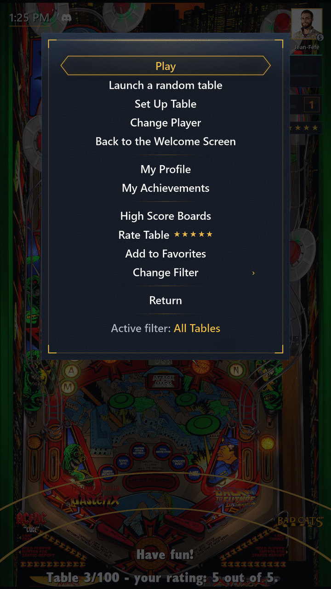

# Interface

[← Sommaire du guide](index.md)

## PinballY en 6 langues

Les menus et messages de PinballY enfin en français, mais aussi en allemand, espagnol, italien et portugais, en plus de l'anglais. Choisissez la langue dans **Réglages du pack**, ou avec `LANGUAGE` dans `.env.local` (voir [Réglages](settings.md)).

## Menus dessinés

Les menus de PinballY et ceux des autres scripts sont dessinés dans le style Steamball du pack, avec les mêmes entrées, rangées en sections, et les mêmes boutons : menu principal, sortie, filtres, extinction, configuration de la table, menu opérateur, pause d'une partie, capture des médias (y compris par lot) et confirmations.

- Dans la pause, Exit et « Annuler » reprennent la partie.
- Un menu principal plus court range toutes les sélections de la roue et les groupes de filtres derrière une seule entrée « Changer de filtre », et nomme sous sa liste le filtre affiché par la roue (« Filtre actif : Toutes les tables »).

## Nettoyage des menus

Le nettoyage des menus allège les menus de PinballY pour tous les Profils, Profils admin compris. Il retire :

- Aide et À propos des menus de sortie et opérateur ;
- Informations, Affiche et Carte d'instructions du menu principal (Noter la table et Ajouter aux favoris restent) ;
- l'entrée Meilleurs scores de PinballY (nommée **Scores de la table** dans le menu principal) quand les meilleurs scores du pack sont désactivés ;
- les groupes Filtrer par système, Filtrer par dernière partie et Filtrer par date d'ajout de « Changer de filtre ».

Elle est **désactivée par défaut**, comme l'horloge du backglass : activez-la avec `ADD_ON_MENU_CLEANUP=true`. Les boutons dédiés de PinballY pour ces écrans, si vous les avez affectés, fonctionnent toujours.

## Sur l'écran de la roue

- Une horloge, l'arc doré de la roue et une ligne d'état enrichie.
- Le badge du Profil actif et son niveau, la carte du Défi de la semaine et la barre de maîtrise.

## Icônes d'état

De petites icônes se placent à droite de l'horloge de la roue, sur sa ligne, à la hauteur de ses chiffres. Chacune ne s'affiche que tant que ce qu'elle signale dure :

- Le symbole blanc de Discord, pour tout le monde, Invité et Profils enfant compris : Discord montre la borne publiquement en ce moment (voir [Discord Rich Presence](settings.md#discord-rich-presence)). Pas de symbole, rien de public : Discord Rich Presence est désactivé, Discord n'a pas encore répondu ou reste injoignable, ou le mode attract est en cours.
- Une flèche dorée pointée vers le bas, seulement pour qui voit les entrées de configuration (un [Profil admin](settings.md#profil-admin), ou n'importe qui tant qu'aucun Profil n'est marqué) : une version plus récente du pack attend (voir [Mises à jour](updates.md)).
- Une flèche circulaire blanche, barrée, seulement pour qui voit les entrées de configuration : la recherche de mises à jour du pack est désactivée.

Elles gardent leur place quand la minute change et quand l'horloge est désactivée, se cachent pendant une partie et suivent le Profil actif après « Changer de joueur ». Une icône qui apparaît ou disparaît pendant que vous êtes sur la roue le fait en un seul fondu. Pour les désactiver : « Icônes d'état » dans le groupe Écran de la roue des **Réglages du pack**, ou `ADD_ON_STATUS_ICONS=false`.

## Lancements, attentes et sons

- Un lancement sans flash noir, avec une comète dorée qui tourne pendant l'attente, l'étape en cours écrite en doré dessous quand une table se lance ou se ferme (« Chargement en cours… », « Retour aux tables… ») : au lancement, au démarrage, pendant la lecture d'un tableau des scores et pendant la préparation des statistiques, de la liste des succès et de la liste des cadres d'Avatar.
- Le backglass masqué pendant une partie.
- Des sons au lancement, aux succès, à l'accueil, aux confettis et au feu d'artifice, ou les vôtres (voir [Réglages](settings.md)).

## Horloge du backglass

Pendant une partie, l'horloge du backglass affiche l'heure dans un petit cadre noir bordé d'un filet doré, soulignée de doré comme celle de la roue, devant le backglass de VPX, au même format que l'horloge de la roue. Elle apparaît dès le lancement de la table, pendant son chargement, change avec la minute et disparaît à la fin de la partie ou si le lancement échoue. Elle ne s'affiche jamais sur une borne à un seul écran, ni pendant que PinballY capture les médias d'une table.

Elle est **désactivée par défaut** : activez-la dans les Réglages du pack ou avec `ADD_ON_BACKGLASS_CLOCK=true`. À sa première partie, le cadre s'ouvre en haut à gauche de l'écran du backglass. Déplacez-le et redimensionnez-le comme les autres fenêtres de PinballY ; PinballY retient où vous l'avez mis, le cadre y reste désormais tant qu'il est sur l'écran du backglass (ailleurs, il revient en haut à gauche à la partie suivante), et l'heure grandit avec lui. Un backglass réglé pour rester au premier plan (« FormToFront » de B2S activé) peut la cacher.

---

[← Sommaire du guide](index.md)
