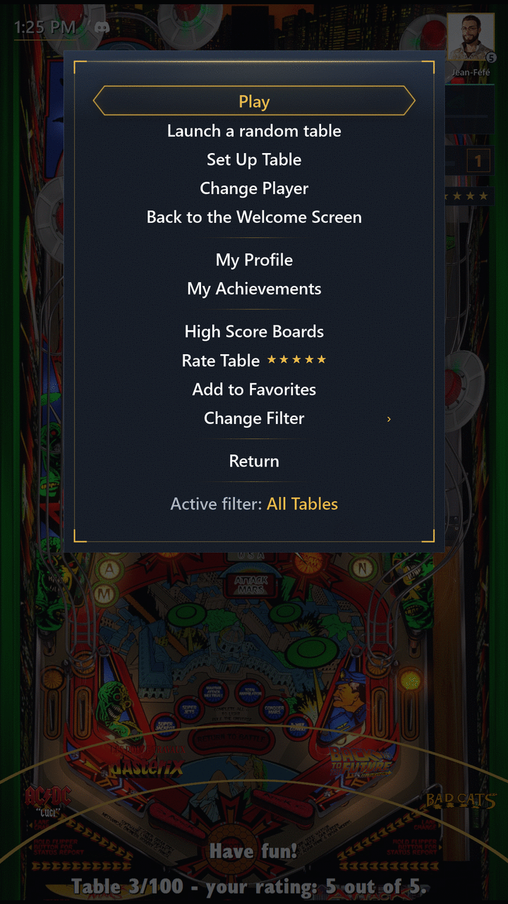

# Interface

[← Sommaire du guide](index.md)

## PinballY en 6 langues

Les menus et messages de PinballY enfin en français, mais aussi en allemand, espagnol, italien et portugais, en plus de l'anglais. Choisissez la langue dans **Réglages de l'eXpansion pack**, ou avec `LANGUAGE` dans `.env.local` (voir [Réglages](settings.md)).

## Menus dessinés

Les menus de PinballY et ceux des autres scripts sont dessinés dans le style Steamball du pack, avec les mêmes entrées, rangées en sections, et les mêmes boutons : menu principal, sortie, filtres, extinction, configuration de la table, menu opérateur, pause d'une partie, capture des médias (y compris par lot) et confirmations.

- Dans la pause, Exit et « Annuler » reprennent la partie.
- Au pied d'un écran dessiné, les indications nomment les boutons de la borne : « Gauche » et « Droite » (les flippers, boutons Prev et Next de PinballY) pour parcourir ou faire défiler, « Select » pour choisir, « Exit » pour revenir ou fermer.
- Sur tous les menus et écrans dessinés, Select, Launch ou Exit gardé enfoncé ne compte qu'une fois, alors qu'un flipper gardé enfoncé continue de défiler.
- Les menus et écrans dessinés jouent les sons des boutons de PinballY, comme la roue : les vôtres s'ils sont dans `Media\Button Sounds`, au volume des boutons de PinballY. **Mute Buttons** dans le menu opérateur les coupe tous ; un `Silence.wav` (dans le dossier `Assets` de PinballY) copié sous le nom d'un son en coupe un seul, par exemple `Next.wav` et `Prev.wav` pour les déplacements.
- Le menu principal est rangé en sections : jouer (Jouer, Lancer une table au hasard) ; la table sélectionnée (Ajouter aux favoris, Noter la table, puis Configurer la table pour un Profil admin) ; les écrans du pack (Mon profil, Mes succès, Tableaux des meilleurs scores) ; ce qui change (Changer de joueur, Revenir à l'écran d'accueil, Changer de filtre) ; enfin Retour, seul. Changer de filtre est à deux appuis sur Gauche depuis Jouer.
- Un menu principal plus court range toutes les sélections de la roue et les groupes de filtres derrière une seule entrée « Changer de filtre », et nomme sous sa liste le filtre que vous avez choisi (« Filtre actif : Toutes les tables »), puis l'[ordre de la roue](choosing_a_table.md#ordre-de-la-roue) (« Ordre de la roue : Alphabétique »), à titre d'information.

## Nettoyage des menus

Le nettoyage des menus allège les menus de PinballY pour tous les Profils, Profils admin compris. Il retire :

- Aide et À propos des menus de sortie et opérateur ;
- Informations, Affiche et Carte d'instructions du menu principal (Noter la table et Ajouter aux favoris restent) ;
- l'entrée Meilleurs scores de PinballY (nommée **Scores de la table** dans le menu principal) quand les meilleurs scores du pack sont désactivés ;
- les groupes Filtrer par dernière partie et Filtrer par date d'ajout de « Changer de filtre » ;
- le groupe Filtrer par système, seulement si vos tables configurées utilisent un seul système (Visual Pinball X seul, par exemple) : avec deux systèmes ou plus (Visual Pinball X et Pinball FX, par exemple), il reste.

Elle est **désactivée par défaut**, comme l'horloge du backglass : activez-la avec `ADD_ON_MENU_CLEANUP=true`. Les boutons dédiés de PinballY pour ces écrans, si vous les avez affectés, fonctionnent toujours.

## Sur l'écran de la roue

- Une horloge, l'arc doré de la roue et une ligne d'état enrichie.
- Le badge du Profil actif et son niveau, la carte du Défi de la semaine et la barre de maîtrise.
- Juste sous la carte du Défi (ou à sa place quand les Défis sont désactivés), la carte rose du Défi de la maison : le [Défi de la maison](achievements_and_challenges.md#défi-de-la-maison) de la semaine et la progression de la maison, la même pour tous les profils. Comme la carte du Défi, elle annonce « réussi » jusqu'au dimanche une fois l'objectif atteint par la maison, et montre quelques secondes le verdict de la semaine passée au début de la suivante. Elle est absente une semaine sans Défi de la maison ; quand elle est là, le rail de la roue descend un peu, pour rester à mi-chemin entre la barre de maîtrise et l'arc de la roue.
- En haut à droite, à côté du badge et au-dessus de la carte du Défi (ou à la place de la carte quand les Défis sont désactivés), cinq étoiles : la note du Profil actif pour la table sélectionnée, demi-étoiles comprises, vides sur une table que vous n'avez pas notée. Elles sont toujours là, pour que le coin ne saute pas d'une table à l'autre ; seul **Notes par Profil** désactivé les retire.
- Le long du bord droit, le rail de la roue : `#` puis A à Z (des décennies avec l'ordre de la roue par année, voir [Choisir une table](choosing_a_table.md#ordre-de-la-roue)), les lettres sans table sur la roue grisées, et une pastille dorée sur la lettre de la table sélectionnée (`#` pour un titre qui commence par un chiffre ou un symbole ; une lettre accentuée compte comme la lettre simple, « Élan Vital » est donc sous E). La pastille bouge avec la roue, Page suivante et Page précédente comprises, et les lettres grisées suivent un filtre choisi, Changer de joueur et une table retirée de vos tables favorites. Il n'y a pas de rail sur « Tables les plus jouées » et « Mes meilleurs scores », qui ne sont pas dans l'ordre alphabétique ; il se cache pendant une partie et n'apparaît pas sur une roue vide (voir [Choisir une table](choosing_a_table.md#ordre-de-la-roue)). Après 3 secondes sans mouvement, le rail glisse hors de l'écran par la droite en s'effaçant, et revient à sa place au mouvement suivant, ou quand ses lettres changent (un filtre, l'ordre de la roue, Changer de joueur). Les 3 secondes continuent de courir sous les menus : le rail est parti quand vous en fermez un sur la même table ; au démarrage, elles ne commencent qu'à la fermeture de l'écran d'accueil. `WHEEL_RAIL_SECONDS` change ce délai, ou garde le rail toujours affiché avec `0` (voir [Réglages](settings.md#envlocal)).
- Tout en bas à droite, la position dans la roue : la place de la table sélectionnée parmi les tables de la roue, par exemple `17/100`. Elle compte dans l'ordre de la roue : par année quand l'[ordre de la roue](choosing_a_table.md#ordre-de-la-roue) est par année, meilleure place d'abord sur Mes meilleurs scores. Elle suit chaque mouvement de la roue, un filtre choisi et Changer de joueur ; elle reste sous les menus, se cache pendant une partie et n'apparaît pas sur une roue vide.
- Tout en bas à gauche, le cœur des favoris : rouge quand la table sélectionnée est l'une de vos tables favorites, gris sinon ; Invité voit les siennes, et sans **Notes par Profil**, il montre les favoris de PinballY, communs à la borne. Il change dès le retour sur la roue après « Ajouter aux favoris » ou « Retirer des favoris », ou après Changer de joueur, et suit les mouvements de la roue et se cache comme la position dans la roue (voir [Notes et tables favorites](profiles.md#notes-et-tables-favorites)).
- En mode attract, la carte du Défi, la carte du Défi de la maison, les cinq étoiles, la barre de maîtrise, le rail de la roue, la position dans la roue et le cœur des favoris se cachent, pour laisser les tables seules ; l'horloge et le badge restent. Ils reviennent à la première pression sur un bouton, sur la table où le mode attract s'est arrêté.
- La ligne d'état du bas finit par la note de la maison pour la table sélectionnée (« Note de la maison : 3,5 sur 5 (4 avis). »), ou votre propre note quand moins de deux d'entre vous l'ont notée (« Votre note : 4 sur 5. »), sinon « Aucune note pour cette table. ». Elle suit une notation tout de suite, et n'apparaît pas quand **Notes par Profil** est désactivé (voir [Notes et tables favorites](profiles.md#notes-et-tables-favorites)).
- La position dans la roue remplace le « Table 3/120 - » qui ouvrait chaque message de la ligne d'état du bas : ils se lisent « Sorti en 1984. », « Fabriqué par Williams. ». Sans la position dans la roue (`WHEEL_POSITION=false`, ou l'Add-on **Repères de la roue** désactivé), les messages redonnent la position : « Table 3/120 - sorti en 1984. ».

## Icônes d'état

De petites icônes se placent à droite de l'horloge de la roue, sur sa ligne, à la hauteur de ses chiffres. Chacune ne s'affiche que tant que ce qu'elle signale dure :

- Le symbole blanc de Discord, pour tout le monde, Invité et Profils enfant compris : Discord montre la borne publiquement en ce moment (voir [Discord Rich Presence](settings.md#discord-rich-presence)). Pas de symbole, rien de public : Discord Rich Presence est désactivé, ou Discord n'a pas encore répondu ou reste injoignable.
- Une flèche dorée pointée vers le bas, seulement pour qui voit les entrées de configuration (un [Profil admin](settings.md#profil-admin), ou n'importe qui tant qu'aucun Profil n'est marqué) : une version plus récente du pack attend (voir [Mises à jour](updates.md)).
- Une flèche circulaire blanche, barrée, seulement pour qui voit les entrées de configuration : la recherche de mises à jour du pack est désactivée.

Elles gardent leur place quand la minute change et quand l'horloge est désactivée, se cachent pendant une partie et suivent le Profil actif après « Changer de joueur ». Une icône qui apparaît ou disparaît pendant que vous êtes sur la roue le fait en un seul fondu. Pour les désactiver : « Icônes d'état » dans le groupe Roue des **Réglages de l'eXpansion pack**, ou `ADD_ON_STATUS_ICONS=false`.

## Lancements, attentes et sons

- Un lancement sans flash noir, avec une comète dorée qui tourne pendant l'attente, l'étape en cours écrite en doré dessous quand une table se lance ou se ferme (« Chargement en cours… », « Retour aux tables… ») : au lancement, au démarrage, pendant la lecture d'un tableau des scores et pendant la préparation des statistiques, de la liste des succès et de la liste des cadres d'Avatar.
- Pendant qu'une table se charge et se ferme, la comète tourne aussi, seule, au milieu du backglass, jamais pendant que PinballY capture les médias d'une table.
- Le backglass masqué pendant une partie, et affiché au démarrage dès deux écrans, même après une borne éteinte en pleine partie. S'il reste caché, le journal de PinballY dit combien d'écrans Windows voyait au démarrage (une TV encore en veille compte comme absente).
- Des sons au lancement, aux succès, à l'accueil, aux confettis et au feu d'artifice, ou les vôtres (voir [Réglages](settings.md)).

## Horloge du backglass

Pendant une partie, l'horloge du backglass affiche l'heure dans un petit cadre au dégradé bleu des menus Steamball, bordé d'un filet doré, devant le backglass de VPX, avec le même format, la même ombre portée et le même soulignement doré que l'horloge de la roue. Elle apparaît dès le lancement de la table, pendant son chargement, change avec la minute et disparaît à la fin de la partie ou si le lancement échoue. Elle ne s'affiche jamais sur une borne à un seul écran, ni pendant que PinballY capture les médias d'une table.

Elle est **désactivée par défaut** : activez-la dans les Réglages de l'eXpansion pack ou avec `ADD_ON_BACKGLASS_CLOCK=true`. À sa première partie, le cadre s'ouvre tout en haut à droite de l'écran du backglass. Pendant une partie, faites-le glisser à la souris : sa position est enregistrée à la fin de la partie et reprise aux suivantes, même après un redémarrage de PinballY. Un clic peut le faire passer derrière le backglass : il revient devant en moins de deux secondes et se déplace alors normalement. Évitez le clic droit : son menu peut faire pivoter le contenu du cadre. Un backglass réglé pour rester au premier plan (« FormToFront » de B2S activé) peut la cacher.

---

[← Sommaire du guide](index.md)
