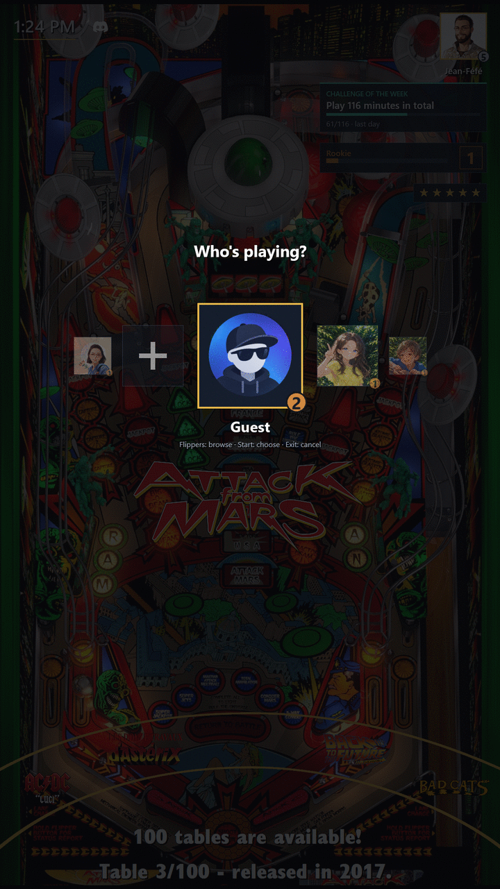
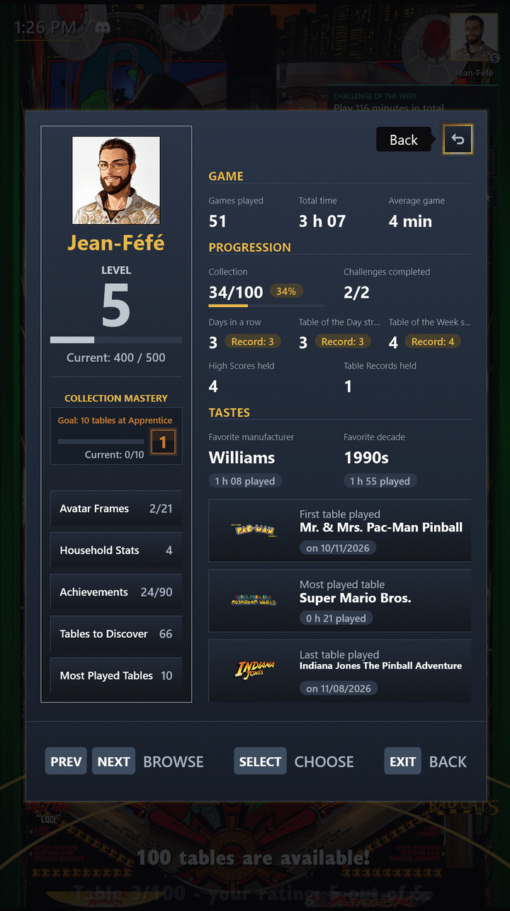

# Profils

[← Sommaire du guide](index.md)

## Un Profil pour chacun

Avec « Changer de joueur », chacun prend son Profil et son Avatar, et l'écran d'accueil vous salue par votre nom : vous savez pour qui les parties vont compter.

- Seules les parties d'au moins une minute comptent : un lancement par erreur ne fausse rien.
- Vos jours d'affilée sur la borne comptent les jours de suite où vous avez joué, sur n'importe quelle table.
- Le Profil Invité reste toujours là pour les visiteurs.
- Dès que la borne compte au moins deux Profils sans compter Invité, PinballY démarre sur « Changer de joueur », pour que chacun choisisse son Profil avant de jouer ; il peut aussi démarrer sur l'écran d'accueil ou directement sur la roue (`STARTUP_SCREEN`, voir [Réglages](settings.md)).
- Tant que « Changer de joueur » est ouvert, le son des vidéos de la table de la roue est baissé, et revient à sa fermeture.

La progression de chaque Profil est enregistrée dans `Scripts\ExpansionPack\profiles`. Un Profil admin garde les entrées de configuration pour lui, un Profil enfant cache les tables pour adultes, et **Gérer les profils**, dans le menu de sortie d'un Profil admin, marque un Profil enfant ou fait repartir un Profil de zéro : voir [Réglages](settings.md).

## Créer un Profil

Le pack est livré avec le seul Profil Invité. Un Profil se crée depuis la borne ou depuis Windows.

### Depuis la borne

Ouvrez **Changer de joueur** : sa dernière place, après le dernier Profil, est **Nouveau profil**, le « + ». Elle apparaît à tout le monde tant qu'aucun Profil n'est admin, Invité compris ; dès qu'il y en a un, aux Profils admin seulement.

1. Choisissez le « + » avec Select ou Launch : la saisie du nom s'ouvre.
2. Parcourez l'anneau de caractères avec les flippers, en maintenant l'un d'eux pour continuer. Select ou Launch choisit le caractère sous le marqueur : `A` à `Z`, `a` à `z`, `-`, `←` pour effacer le dernier caractère, et `OK`.
3. Choisissez `OK`. `OK` reste grisé tant que le nom est vide ou refusé. Le Profil est créé, et le Choix de l'Avatar s'ouvre.
4. Le Choix de l'Avatar montre 24 portraits sous le nom du nouveau Profil. Parcourez-les avec les flippers, en maintenant l'un d'eux pour continuer ; Select ou Launch prend aussitôt le portrait sous le marqueur. Exit, ou le bouton Exit avant le premier portrait, demande « Garder l'Avatar par défaut ? » dans un petit panneau sur les portraits : « Choisir un Avatar », le choix proposé d'abord, ou Exit, ramène les portraits avec le marqueur là où il était ; « Garder l'Avatar par défaut » sort sans portrait. Tant que le Choix de l'Avatar s'ouvre encore, avant que les portraits s'affichent, Exit sort aussitôt sans rien demander, et le nouveau Profil garde l'Avatar par défaut.
5. « Changer de joueur » revient sur le nouveau Profil, à sa place dans l'ordre alphabétique, avec son Avatar. Vous êtes toujours sur votre ancien Profil : appuyez sur Select pour choisir le nouveau.

Dans la saisie du nom, Exit revient sur le « + » sans rien créer. Sur une borne laissée inactive, le mode attract ferme la saisie du nom et « Changer de joueur », sans rien créer non plus ; pendant le Choix de l'Avatar, même quand il demande de confirmer, il les ferme aussi sans rien demander, et le Profil déjà créé garde l'Avatar par défaut. Deux Profils peuvent prendre le même portrait. Une fois créé, un Profil ne change d'Avatar que depuis Windows.

Un nom compte 12 caractères au maximum, sans accents, espaces ni chiffres. Pour un nom plus long ou accentué, renommez le dossier du Profil dans Windows, **avant de jouer** : renommer garde les parties et les Succès du Profil, mais ses meilleurs scores et ses records perdus suivent le nom, et renommer le dossier du Profil actif repart sur Invité.

Quelle que soit la casse, la saisie du nom refuse le nom d'Invité, `guest` ou tel que votre langue l'affiche, les noms que Windows se réserve (`CON`, `PRN`, `AUX`, `NUL`) et le nom d'un Profil déjà listé, et écrit pourquoi sous l'anneau. Rien d'autre n'est refusé : un Profil mis de côté en `_Max` ou un Profil supprimé laisse son nom libre. Un tiret ne fait rien au début d'un nom ou juste après un autre, et un tiret final est retiré : « Max- » est créé sous le nom « Max ».

Si le dossier ne peut pas être créé, la saisie du nom reste ouverte avec votre nom et le dit en une phrase : vérifiez le dossier `profiles` dans Windows et réessayez. L'erreur est dans le journal des erreurs.

**Le premier Profil.** Tant que la borne n'a aucun Profil en plus d'Invité, la saisie du nom affiche une ligne de plus, en jaune : le Profil que vous créez devient Profil admin à la place d'Invité. Choisissez-le dès que « Changer de joueur » revient sur lui : d'ici là, vous restez sur Invité, qui ne voit plus ni les entrées de configuration ni le « + ». Si sa marque ne peut pas être enregistrée, le Profil est gardé, l'erreur est dans le journal des erreurs, et vous pouvez toujours le choisir puis prendre **Devenir admin** dans **Gérer les profils**. Un Profil créé quand la borne en a déjà un ne reçoit aucune marque, même si aucun n'est admin, pas plus qu'un premier Profil créé depuis Windows.

### Depuis Windows

1. Dans `PinballY\Scripts\ExpansionPack\profiles`, créez un dossier vide au nom du joueur : c'est ce nom que la borne affiche. Un nom qui commence par `.` ou `_` est ignoré. Ne copiez pas le dossier d'Invité : la copie reprendrait sa progression, alors qu'un dossier vide part de zéro.
2. Facultatif : placez dans ce dossier une image PNG ou JPEG carrée nommée `avatar.png` ou `avatar.jpg`. Si les deux sont là, `avatar.jpg` l'emporte : une photo déposée sous le nom `avatar.jpg` s'affiche à la place du portrait que le Choix de l'Avatar a copié en `avatar.png`. Sans aucune des deux, le Profil reçoit l'Avatar par défaut, une simple silhouette grise. Un `avatar.png` ou `avatar.jpg` remplacé par un autre fichier du même nom pendant que PinballY tourne s'affiche à son prochain démarrage.
3. Ouvrez **Changer de joueur**, dans le menu principal ou le menu de sortie, et choisissez le nouveau Profil. Inutile de redémarrer PinballY. Tant que vous ne l'avez pas choisi, vous jouez toujours en Invité.
4. Facultatif : pour garder les entrées de configuration pour vous seul, ouvrez **Gérer les profils** dans le menu de sortie et choisissez **Devenir admin** (voir [Profil admin](settings.md#profil-admin)).

Configurer le pack ne demande pas de Profil admin : tant qu'aucun Profil n'est marqué, tous les Profils, Invité compris, voient les entrées de configuration.

## Mon profil

**Mon profil**, dans le menu principal, résume votre vie de flippeur :

- parties jouées, temps total et durée moyenne d'une partie ;
- votre niveau et la maîtrise de votre collection ;
- fabricant, décennie et table préférés, et la toute première table jouée ;
- la part de la collection que vous avez essayée, sans les tables masquées ni les tables non configurées ;
- vos succès, vos jours d'affilée sur la borne, vos séries sur la table du jour et la table de la semaine, et les défis réussis ;
- les meilleurs scores et records que vous détenez encore ;
- le cadre que porte votre Avatar (à choisir sous **Cadre**, voir [Maîtrise des tables](choosing_a_table.md#maîtrise-des-tables)) ;
- et le chemin vers vos tables les plus jouées et celles qui restent à découvrir.

## Stats de la maison

Dès que vous êtes deux à avoir un Profil, **Stats de la maison** montre tous les Profils côte à côte, sauf Invité, chaque Avatar dans son cadre, le meilleur de chaque ligne en doré, et qui détient le plus de records. Choisissez une colonne pour voir les statistiques de ce Profil.

---

[← Sommaire du guide](index.md)
